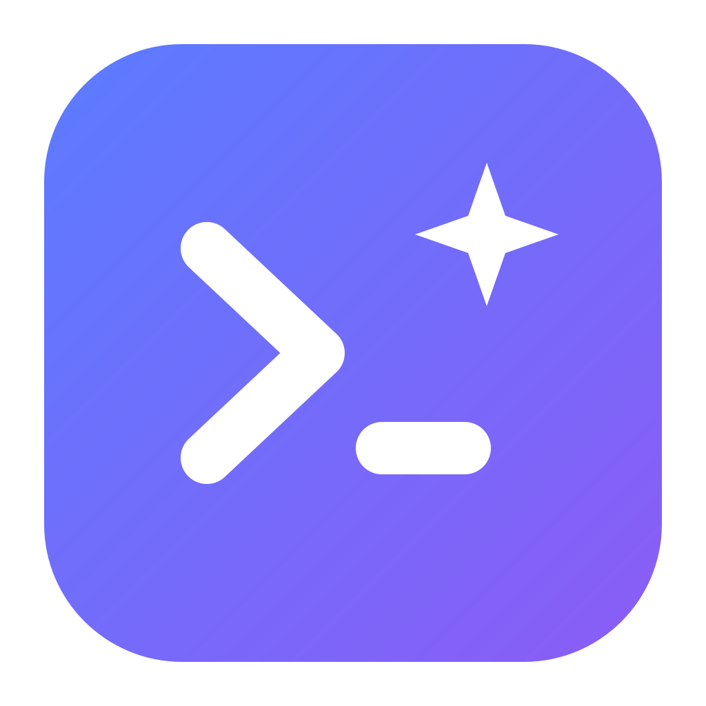

<p align="center">
  
</p>

<h1 align="center">Aime - AI Mini Editor</h1>

<p align="center">
  An AI-first desktop code editor for Windows, macOS and Linux.<br/>
  Built on Tauri 2, React and Monaco, driven by the AI coding CLIs you already use.
</p>

---

## Why Aime?

AI coding CLIs such as Claude Code and Codex are already complete agents: they read and edit files, run
commands and keep sessions. Aime does not rebuild the agent. It is the editor around it: one window where
the AI works on your project and you can see, steer, review and undo what it does.

- **The AI is the main panel, not a sidebar.** Streaming answers, tool calls folded into readable steps,
  model and reasoning-effort pickers, three permission levels and per-session token and cost totals.
- **Every change is reversible.** Each AI turn that touched files offers _Undo this turn_, which restores
  every file exactly as it was, including files the AI created.
- **Any CLI, not one vendor.** Claude Code and Codex are built in. Any other command-line AI can be added
  from a `providers.json` entry, with no new release needed.
- **Still a real editor without AI.** File tree, Monaco, language servers, Git, terminal, tasks and the
  debugger all work with no AI CLI installed.

## Features

**AI**

- Chat per project, resumed with full context after a restart
- Model and effort read from the installed CLI itself, so new models appear without an Aime update
- MCP server manager with a curated catalogue of servers
- Inline suggestions at the cursor and "ask about this code" actions
- AI review of staged changes before a commit
- _Work with AI_: hand over a work item and the AI takes it from understanding to a verified change,
  with each step ending at a check the AI does not grade itself
- Flows: pipelines drawn on a canvas and run on demand

**Editor**

- Workspace tabs, several projects side by side in one window, each reopened exactly as it was left
- Language servers for TypeScript, Python, Go, Rust, SQL, C# (Roslyn), Java and more, installed on demand:
  completions, hover, go to definition, implementations and references
- Debugger over the Debug Adapter Protocol: JavaScript/TypeScript, Python, Go, C# and F#
- Run, build, test, check and publish tasks detected from the project, with _Fix with AI_ on a failure
- Integrated terminal (PowerShell on Windows, your `$SHELL` on macOS and Linux)
- Plugins running in a sandboxed worker with declared capabilities

**Git**

- Stage, commit, amend, stash, push and pull
- Branches, remotes and tags, revert, cherry-pick and reset
- Several repositories in one folder, each with its own changes
- Side-by-side diffs, blame and a three-way merge conflict view with AI-assisted merging

**Work and cloud**

- Work items from Azure DevOps, Jira, ClickUp and GitHub, tied to branches in the repository
- A cloud console for Azure, AWS, Google Cloud and Supabase, driven through each provider's own CLI

**Everyday**

- Command palette, searchable in-app help (F1), English and Vietnamese UI, dark and light themes
- Signed auto-updates with stable and beta channels
- _Take to another machine_: chat history and project memory packed into one local file

## Architecture

| Layer   | Technology                                    |
| ------- | --------------------------------------------- |
| Shell   | Tauri 2 (Rust)                                |
| UI      | React 19, TypeScript, Tailwind CSS 4, zustand |
| Editor  | Monaco, bundled locally and working offline   |
| Tooling | LSP and DAP clients, xterm.js on a native PTY |

Every AI CLI is reached through an adapter that normalizes its output into one event set, so the UI never
knows which CLI is answering. `src-tauri/src/providers/adapter.rs` is the whole contract.

```
src/                React frontend: components, stores (zustand), lib, i18n
src-tauri/src/      Rust backend
  providers/        AI CLI adapters (Claude Code, Codex, user-defined)
  lsp/  dap/        language server and debug adapter clients
  git/  tasks/      Git operations, task detection and execution
  cloud/  trackers/ cloud consoles and work-item services
e2e/                WebDriver tests that drive the real app
```

## Running from source

Requirements: Node.js 20 or later, and Rust stable (with the MSVC toolchain on Windows). On Linux, install
the [Tauri system dependencies](https://v2.tauri.app/start/prerequisites/) first.

```bash
npm install
npm run tauri dev      # run the app; the first Rust build takes a while
npm run tauri build    # build the installers
```

For the AI features, install at least one supported CLI and sign in from the key button in the AI panel:

```bash
npm install -g @anthropic-ai/claude-code   # Claude Code
npm install -g @openai/codex               # Codex
```

## Quality checks

```bash
npm run check                         # Prettier, ESLint (strict, type-checked) and tsc
npm test                              # frontend unit tests (Vitest)
cd src-tauri && cargo test            # backend tests
npm run test:e2e -- --spec <spec>     # end-to-end, see e2e/README.md
```

A pre-commit hook (`.githooks/`, enabled with `git config core.hooksPath .githooks`) runs Prettier,
ESLint and `cargo fmt --check` on every commit.

## License

[GPL-3.0](LICENSE)
